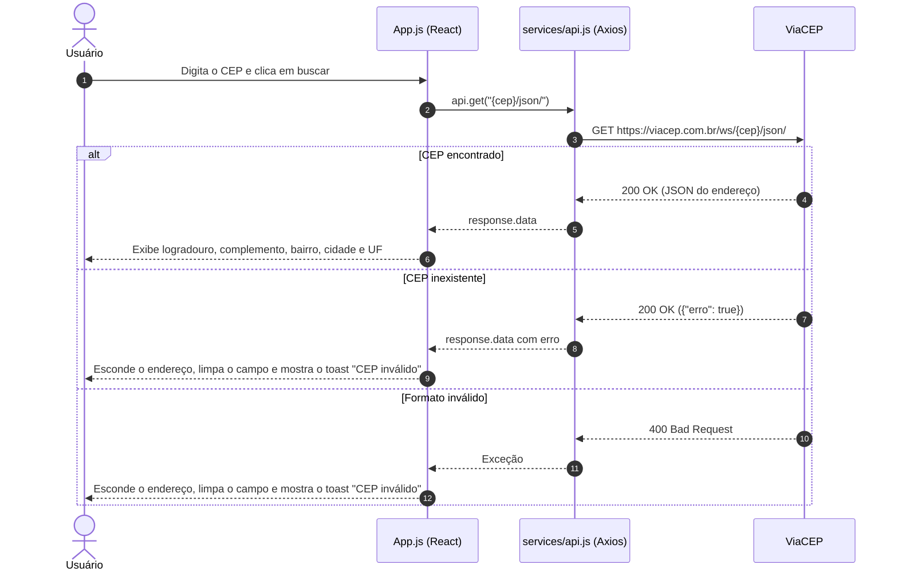

# 📮 CEP Web — Buscador de Endereço por CEP


> Digite um CEP e veja o endereço correspondente na hora.

O **CEP Web** é o meu primeiro projeto com **React**: uma página única, criada com **Create React App**, em que o usuário informa um CEP e recebe logradouro, complemento, bairro, cidade e UF consultando a API pública do **[ViaCEP](https://viacep.com.br)** via **Axios**.



---

## ✨ O Problema
Descobrir o endereço de um CEP normalmente exige abrir o site dos Correios ou uma busca genérica, com formulários e páginas cheias de informação extra.

---

## 🚀 A Solução
Uma tela mínima com um único campo:
- **Busca direta**: o CEP digitado é enviado ao ViaCEP ao clicar no botão de busca.
- **Resultado enxuto**: o endereço aparece logo abaixo do campo, em duas linhas (logradouro e complemento; bairro, cidade e UF).
- **Feedback de erro**: para CEP com formato inválido ou inexistente (o ViaCEP responde `200` com `{"erro": true}`), um toast "CEP inválido" aparece no canto inferior direito, o campo é limpo e o endereço anterior é escondido.

---

## 🎯 Diferenciais
- **Sem backend**: o navegador consulta o ViaCEP diretamente.
- **Cliente HTTP isolado**: a instância do Axios com a `baseURL` do ViaCEP fica em `src/services/api.js`.
- **Pouquíssimas dependências de UI**: apenas `react-icons` (ícone de busca) e `react-toastify` (notificação de erro).

---

## 🛠️ Stack Tecnológica

| Camada | Tecnologia |
|---|---|
| **Framework** | React 18 (componente funcional com `useState`) |
| **Build / Dev Server** | Create React App (`react-scripts` 5.0.1) |
| **HTTP** | Axios 1 |
| **Ícones** | react-icons 4 (`FiSearch`) |
| **Notificações** | react-toastify 9 |
| **Estilos** | CSS puro (`src/index.css` e `src/style.css`) |
| **API de endereços** | ViaCEP |

---

## 🏛️ Arquitetura

Aplicação de um único componente, sem rotas nem gerenciamento de estado externo:

```
index.js          ← Monta o <App /> no #root (React.StrictMode)
   ↓
App.js            ← Estado do input e do endereço, busca e renderização
   ↓
services/api.js   ← Instância do Axios com baseURL do ViaCEP
```

---

## 🗺️ Telas & Rotas

| Rota | Tela | O que entrega |
| :--- | :--- | :--- |
| `/` | Buscar CEP | Campo de CEP, botão de busca e o endereço encontrado |

### Captura de tela

<p align="center"></p>

---

## 📁 Estrutura do Projeto

```text
cep-web/
├── images/
│   └── 01.png               # Captura de tela usada no README
├── public/                  # index.html, favicon, manifest e ícones padrão do CRA
├── src/
│   ├── services/
│   │   └── api.js           # Instância do Axios (baseURL do ViaCEP)
│   ├── App.js               # Tela de busca e lógica da consulta
│   ├── index.js             # Ponto de entrada do React
│   ├── index.css            # Estilos globais
│   └── style.css            # Estilos da tela
├── LICENSE.txt
├── package.json
└── package-lock.json
```

---

## ⚡ Quick Start

### Pré-requisitos
- [Node.js](https://nodejs.org/) e npm

### 1. Clonar o repositório
```bash
git clone https://github.com/matheusnascimentods/cep-web.git
cd cep-web
```

### 2. Instalar e executar
```bash
npm install
npm start
```

A aplicação estará disponível em: **`http://localhost:3000`**

---

## 💻 Comandos Úteis

```bash
# Iniciar o servidor de desenvolvimento
npm start

# Gerar o build de produção (pasta build/)
npm run build

# Rodar o runner de testes do CRA (o projeto ainda não tem testes)
npm test
```

---

## 🔌 API Reference (Recursos Consumidos)

| Método | Rota | Uso na interface |
| :--- | :--- | :--- |
| `GET` | `https://viacep.com.br/ws/{cep}/json/` | Busca do endereço; usa os campos `logradouro`, `complemento`, `bairro`, `localidade` e `uf` |

---

## 🔒 Segurança & Boas Práticas

- **Sem chaves nem segredos**: o ViaCEP é público e não exige autenticação; o projeto não tem variáveis de ambiente.
- **Sem validação no cliente**: o valor digitado vai direto para a URL, sem máscara nem checagem de 8 dígitos; quem rejeita formatos inválidos é o ViaCEP.
- **Sem testes automatizados**: as bibliotecas do Testing Library vêm do template do CRA, mas não há arquivos de teste.

---

## 🤝 Contribuindo

1. Faça um Fork do projeto
2. Crie uma branch para a sua funcionalidade (`git checkout -b feature/nome-da-feature`)
3. Faça o commit das suas alterações (`git commit -m 'feat: implementa nova funcionalidade'`)
4. Envie para o repositório remoto (`git push origin feature/nome-da-feature`)
5. Abra um **Pull Request** detalhando as alterações

---

## 📄 Licença

Distribuído sob a licença MIT. Veja [`LICENSE.txt`](LICENSE.txt) para mais detalhes.

---
Feito com ❤️ por [@matheusnascimentods](https://github.com/matheusnascimentods)
